<div align="center">
  
</div>

<div align="center">

<a href="https://github.com/joaocnds">
  
</a>

<br/>

<a href="https://www.linkedin.com/in/joaocnds">
  
</a>&nbsp;
<a href="mailto:joaovitoorc2@gmail.com">
  
</a>&nbsp;
<a href="https://github.com/joaocnds">
  
</a>

<br/><br/>


</div>


<!-- ═══════════════════════ ABOUT ═══════════════════════ -->


## &nbsp;Sobre mim

<br/>

```yaml
name: "João Vitor Cassiano"
location: "São Paulo, BR 🇧🇷"
company: "Dentsply Sirona — Marketing Digital"
education: "Engenharia de Software 🎓"
interests:
  - "Web & Mobile Development"
  - "Data Engineering & Analytics"
  - "Process Automation"
  - "AI-Powered Solutions"
currently_learning:
  - "React Native + Expo"
  - "TypeScript"
  - "Python para dados"
fun_fact: "Comecei no marketing, mas o código me escolheu 🤓"
```


<!-- ═══════════════════════ JOURNEY ═══════════════════════ -->


## &nbsp;Minha jornada

<br/>

```
📌 Mar 2024 ── Primeiro contato com programação
│               Curso de Programação Web no SENAI
│               HTML, CSS, JavaScript — a faísca acendeu
│
📌 Ago 2024 ── Início na ETEC
│               Técnico em Desenvolvimento de Sistemas
│               Java, lógica, banco de dados, PHP, mobile
│               Android Studio (apps nativos)
│               Descobri automação com n8n e APIs
│
├─── Projetos acadêmicos ao longo do curso
│    ├── Web: HTML, CSS, JS, PHP
│    ├── Desktop: Java Swing, JDBC
│    ├── Mobile: React Native
│    ├── Banco de dados: MySQL, SQL Server
│    └── Automação: n8n, scripts, bots, APIs
│
📌 Dez 2025 ── Conclusão da ETEC ✅
│               Formado em Desenvolvimento de Sistemas
│
📌 Mar 2026 ── Marketing Digital @ Dentsply Sirona
│               Gestão de 5 contas (Instagram, YouTube, Facebook)
│               Agendamento de conteúdos digitais + conta LatAm
│               Salesforce & CIM360 — cadastro e verificação
│               Desenvolvendo MIS Next (plataforma interna)
│               Início em landing pages e campanhas de mídia
│
📌 Ago 2026 ── Engenharia de Software (graduação)
│               Foco em desenvolvimento full-cycle
│               Primeiros projetos autorais publicados
│
📌 Agora ───── Construindo portfólio público
│               Open source, mobile apps, automações com IA
│               Buscando primeira oportunidade em tech
│
🔮 Próximo ─── Contribuir em projetos open source
               Aprofundar em arquitetura de software
               Transição completa para engenharia
```


<!-- ═══════════════════════ TECH STACK ═══════════════════════ -->


## &nbsp;Tech Stack

<br/>

<div align="center">

###  Frontend & Mobile
<a href="https://skillicons.dev">
  
</a>

<br/><br/>

###  Backend & Linguagens
<a href="https://skillicons.dev">
  
</a>

<br/><br/>

###  Dados, Cloud & Automação
<a href="https://skillicons.dev">
  
</a>
&nbsp;&nbsp;


<br/><br/>

###  Ferramentas
<a href="https://skillicons.dev">
  
</a>

</div>

<br/>

<div align="center">
  
</div>

<br/>

<details>
<summary><b>🎯 O que estou aprendendo agora (Nov 2026)</b></summary>

<br/>

| Área | Foco | Status |
|:-----|:-----|:------:|
| **Mobile** | React Native + Expo — navegação, estado, APIs | 🟢 Em andamento |
| **Tipagem** | TypeScript — types, interfaces, generics | 🟡 Intermediário |
| **Dados** | Python — pandas, automações, web scraping | 🟡 Intermediário |
| **Cloud** | Supabase — auth, realtime, edge functions | 🔵 Explorando |
| **DevOps** | Docker — containers, compose, deploy | 🔵 Explorando |
| **IA** | OpenAI API — integração em fluxos n8n | 🟢 Em andamento |

</details>


<!-- ═══════════════════════ PROJECTS ═══════════════════════ -->


## &nbsp;Projetos em destaque

<br/>

<div align="center">
<table>
<tr>
<td width="50%">

<h3 align="center">
  
  InfraTicket
</h3>
<p align="center">
  <a href="https://github.com/joaocnds/infraticket">
    
  </a>
</p>
<p align="center"><sub>Sistema de chamados de TI com painel dual (usuário + admin).<br/>Classificação automática por palavras-chave e dashboard de métricas.</sub></p>
<p align="center">
  <a href="https://skillicons.dev"></a>
</p>

<details>
<summary><sub>🔍 Funcionalidades</sub></summary>
<sub>

- Login diferenciado (user/admin)
- Abertura de chamados com categorias
- Classificação automática por keywords
- Dashboard com métricas e filtros
- Interface responsiva

</sub>
</details>

</td>
<td width="50%">

<h3 align="center">
  
  Treino & Saúde
</h3>
<p align="center">
  <a href="https://github.com/joaocnds/treino-e-saude">
    
  </a>
</p>
<p align="center"><sub>App mobile completo para treinos, refeições, hidratação e medidas corporais.<br/>Coach semanal inteligente com metas personalizadas.</sub></p>
<p align="center">
  <a href="https://skillicons.dev"></a>
</p>

<details>
<summary><sub>🔍 Funcionalidades</sub></summary>
<sub>

- Plano de treino personalizado
- Registro de refeições com macros
- Controle de hidratação diário
- Medidas corporais com gráficos
- Coach semanal com metas e feedback

</sub>
</details>

</td>
</tr>
<tr>
<td width="50%">

<h3 align="center">
  
  Monetus
</h3>
<p align="center">
  <a href="https://github.com/joaocnds/monetus">
    
  </a>
</p>
<p align="center"><sub>Automação financeira end-to-end: controle de assinaturas,<br/>notificações via WhatsApp e análise com IA generativa.</sub></p>
<p align="center">
  <a href="https://skillicons.dev"></a>
  
  
</p>

<details>
<summary><sub>🔍 Funcionalidades</sub></summary>
<sub>

- Cadastro de assinaturas recorrentes
- Alertas automáticos via WhatsApp
- Análise de gastos com OpenAI
- Dashboard financeiro em tempo real
- Workflow n8n com triggers agendados

</sub>
</details>

</td>
<td width="50%">

<h3 align="center">
  
  ETEC Projects
</h3>
<p align="center">
  <a href="https://github.com/joaocnds/etec-projects">
    
  </a>
</p>
<p align="center"><sub>Acervo completo de projetos acadêmicos — do básico ao avançado.<br/>Java, web, PHP, mobile, SQL e automação.</sub></p>
<p align="center">
  <a href="https://skillicons.dev"></a>
</p>

<details>
<summary><sub>🔍 Destaques do acervo</sub></summary>
<sub>

- **Java:** POO, herança, interfaces, JDBC, Swing
- **Web:** Sites responsivos, formulários, APIs
- **PHP:** CRUD, sessões, integração MySQL
- **Mobile:** Apps React Native com Expo
- **SQL:** Modelagem, procedures, triggers
- **Automação:** Bots, web scraping, scripts

</sub>
</details>

</td>
</tr>
</table>
</div>


<!-- ═══════════════════════ DIFFERENTIALS ═══════════════════════ -->


## &nbsp;O que eu trago de diferente

<br/>

<div align="center">
<table>
<tr>
<td width="33%" align="center">


**Visão de Marketing**

<sub>Gerencio 5 contas de redes sociais na Dentsply Sirona, incluindo a conta LatAm. Entendo o usuário final, fluxo de conteúdo e como marketing e produto se conectam.</sub>

</td>
<td width="33%" align="center">


**Mentalidade de Automação**

<sub>Automatizo tudo que é repetitivo. Construo workflows com n8n, integro APIs e uso IA para processos que antes eram manuais.</sub>

</td>
<td width="33%" align="center">


**Projetos Reais**

<sub>Não construo só exercícios — cada projeto resolve um problema real: gestão de TI, saúde pessoal, controle financeiro e até uma plataforma interna para a empresa.</sub>

</td>
</tr>
</table>
</div>


<!-- ═══════════════════════ TROPHIES ═══════════════════════ -->


## &nbsp;Conquistas

<br/>

<div align="center">
  
</div>


<!-- ═══════════════════════ STATS ═══════════════════════ -->


## &nbsp;GitHub Stats

<br/>

<div align="center">
  
  &nbsp;&nbsp;
  
</div>

<br/>

<div align="center">
  
</div>

<br/>

<div align="center">
  
</div>

<br/>

<div align="center">
  
</div>

<div align="center">
  
  
  
</div>


<!-- ═══════════════════════ SNAKE ═══════════════════════ -->


## &nbsp;Contribution Snake

<br/>

<div align="center">
  <picture>
    <source media="(prefers-color-scheme: dark)" srcset="https://raw.githubusercontent.com/joaocnds/joaocnds/output/github-snake-dark.svg" />
    <source media="(prefers-color-scheme: light)" srcset="https://raw.githubusercontent.com/joaocnds/joaocnds/output/github-snake.svg" />
    
  </picture>
</div>


<!-- ═══════════════════════ QUOTE ═══════════════════════ -->


## &nbsp;Dev Quote do dia

<br/>

<div align="center">
  
</div>


<!-- ═══════════════════════ METRICS ═══════════════════════ -->


## &nbsp;Em números

<br/>

<div align="center">

| | |
|:---:|:---:|
|  **Projetos acadêmicos** na ETEC |  **8+** tecnologias no stack |
|  **5** contas gerenciadas (BR & LatAm) |  Formação técnica + graduação |
|  **4** projetos autorais publicados |  **1** plataforma interna em desenvolvimento |

</div>


<!-- ═══════════════════════ FOOTER ═══════════════════════ -->

<div align="center">

<br/>


<br/><br/>

###  Aberto a oportunidades em engenharia de software, dados e automação

<sub>Se curtiu os projetos, deixa uma ⭐ — motiva demais!</sub>

<br/><br/>

<a href="https://www.linkedin.com/in/joaocnds">
  
</a>

<br/><br/>

</div>


